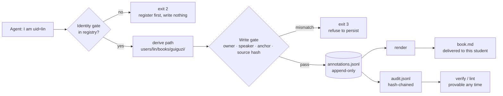

<p align="center">
  <b>One AI tutor can have many students.<br>
  But each student only ever sees their own margin.</b>
</p>

<p align="center">
  <code>Marginalia</code> · multi-user shared-reading notebooks · a deterministic IO layer for AI tutoring
  <br>
  <sub>77 tests · Python 3.9+ · zero dependencies · MIT</sub>
</p>

<p align="center">
  <a href="README.md">中文</a> · English
</p>

---

## Deploy (for agents: this section is enough)

**Paste this to your agent and it will read the protocol and deploy itself:**

> Follow `AGENT_DEPLOY.md` in this repository: install the CLI, run `marginalia setup`,
> self-check with `marginalia setup --check`, then show me the output of `marginalia doctor`.
> If you cannot find the skills directory, ask me — do not guess a path.

**Or run it yourself (four commands):**

```bash
# 1) install the CLI (pick one)
python -m pip install -e .        # or ./bin/marginalia (Windows: bin\marginalia.cmd)

# 2) one command: data root + owner + skill copy + deployment record
marginalia setup --root ./study --skills-dir ~/.claude/skills \
  --owner-open-id <your sender_id> --owner-name Owner

# 3) self-check: the exit code is the verdict
marginalia setup --check

# 4) confirm mode and capability boundary
marginalia doctor
```

| `--check` exit code | State | Meaning | What to do |
|---|---|---|---|
| `0` | `ready` | deployed and verified | start teaching |
| `1` | `absent` / `partial` | not deployed / record missing | go back to step 2 |
| `3` | `stale` | skill copy is out of date | `marginalia setup --force` |
| `3` | `broken` | data integrity problem | `marginalia verify`, do not write |

Deployment never touches student data; `setup` is idempotent. Add `--dry-run` to see the plan without writing.

- Full protocol (with failure branches per step): [AGENT_DEPLOY.md](AGENT_DEPLOY.md)
- Implementation notes (maintainers): [references/deployment.md](references/deployment.md)

---

## The word

**Marginalia** — Latin. The notes left in the *margins* of a page.

Every book that was truly read has them: one line of text, a ring of small handwriting beside it. Not notes, not a book report — the voice that spoke in someone's head at that exact sentence.

The book is the same edition. **The owner of the margin cannot be anyone else.**

That is the one thing this project defends.

---

## The concrete problem it solves

Let an AI teach you a book: feed it the text, have it explain line by line, and record what you asked and what it answered right next to the source. What you get reads like *a book someone read with you*.

With one user, it works beautifully.

Then you introduce that tutor to someone else — a colleague, a student, your family.

The trouble starts with the second person: **it begins writing their notes into your book.**

Not out of malice. In a pure-Markdown world the model is doing free-form text editing:

- it must *remember* who it is currently talking to;
- it must *assemble* the path `study/users/<who>/<which-book>.md`;
- it must *decide* what name goes after `👤 **...**`.

None of these three is validated. Once context grows, sessions multiply, or two people read the same book at once, it slips. Your progress lands in someone else's notebook; their question is signed with your name. And it never announces the mistake — the wrong output looks exactly like the right one.

This is not a model failing to be smart. **It is a missing interface.**

---

## The design in one sentence

> **The model may only say *who it is*. It may not decide *which file to write*.**

Paths are derived from `uid`. `uid` comes from the registry. The speaker name comes from the registry. The source text is locked by a hash. Annotations are append-only. The deliverable is rendered by code, so hand-editing it is meaningless.



If `lin` is a different person, the path *is* a different path. It is not "remembered to be separate" — it is **impossible to be merged**.

---

## What it looks like

The deliverable is an ordinary Markdown book. Source untouched, conversation in the margin:

```markdown
粤若稽古，圣人之在天地间也，为众生之先。

> 🦞 **【Lesson 1 · 2026-11-16】** This line is the door of the whole book.
> "稽古" is not antiquarianism — it attaches the argument to an older source,
> so every later judgement can stand on something.
>
> 👤 **Lin**: So "before all beings" means the sage is one step ahead of everyone?
>
> 💬 **Discussion**: Not earlier in time — **earlier in seeing**. That is why the
> next line is "observe the opening and closing of yin and yang".
>
> ✅ **Progress**: this passage finished 2026-11-16
```

That single file is what the student receives. It opens anywhere. It does not need this project.

---

## Two modes — with the boundary stated honestly

I do not assume your agent can execute commands. So:

| | **A · strict** | **B · portable** |
|---|---|---|
| Requires | Agent can run commands (shell / Python) | Any agent that reads & writes files |
| Isolation | **Hard**: path and speaker derived by code, refused on violation | **Weak**: protocol only, the model *can* violate it |
| When leakage is caught | Before writing (`exit 2/3`) | After the fact (`marginalia lint`), forensics only |
| Use for | Real use, multiple people sharing one agent | Trials, restricted runtimes |

**B is not "equally safe".** It only makes isolation auditable instead of assumed.

If you can choose, choose A.

---

## Five minutes

```bash
git clone https://github.com/hhx465453939/Marginalia.git
cd Marginalia

# either:
python -m pip install -e .        # A. installs the `marginalia` command
./bin/marginalia --version        # B. no install (Windows: bin\marginalia.cmd)

marginalia init --owner-open-id <your sender_id> --owner-name 主人
marginalia user add --open-id <their sender_id> --name Lin --goal "finish the Guiguzi"

marginalia book create --as 主人 --title 鬼谷子 --source ./guiguzi.md
marginalia note add   --as 主人 --book 鬼谷子 --kind explain --lesson 1 \
  --anchor "粤若稽古，圣人之在天地间也，为众生之先。" \
  --text "This line is the door of the whole book."

marginalia verify --check-render --strict   # prove there is no leakage
```

On Windows, change nothing: `bin\marginalia.cmd` handles UTF-8 and CJK arguments.

---

## Commands

| Command | Purpose |
|---|---|
| `init` | create data root + owner study |
| `user add / resolve / list` | student registry (single source of identity) |
| `book create / list` | open a course, register the source text (records sha256) |
| `chapter mark` | chapter status: untouched / in progress / done |
| `progress set` | where you stopped + which sentence to resume from |
| `note add` | append an annotation (`--kind explain\|ask\|dialog\|progress\|variant`) |
| `render` | regenerate `book.md` from the truth sources |
| `export` | final hand-off |
| `verify` | integrity assertions: ownership, speaker, anchor, source hash, audit chain |
| `lint` | audit a **pure Markdown** notebook (mode B forensics) |
| `import` | migrate a legacy single-file notebook (dry-run by default) |
| `stats` / `doctor` | learning stats / environment & capability self-check |

---

## On disk

```
study/
├── registry.json                    ← the only place that defines "who is who"
└── users/<uid>/
    ├── profile.json                 ← this student's goals and pace
    ├── audit.jsonl                  ← who wrote what, when (hash-chained)
    └── books/<slug>/
        ├── meta.json                ← edition, progress, resume point, source sha256
        ├── source.md                ← the text (immutable)
        ├── annotations.jsonl        ← annotations (append-only, source of truth)
        └── book.md                  ← rendered output (for humans, do not edit)
```

`book.md` is not a source of truth. It can always be regrown from the other three files.

---

## Nine gates

| | Blocks |
|---|---|
| G1 identity | an identity missing from the registry writes nothing at all |
| G2 path | `../`, `a/b`, absolute paths, drive letters — rejected at the slug |
| G3 ownership | book uid ≠ study uid → refuse (the canonical leakage shape) |
| G4 speaker | `speaker` is derived from the registry; a hallucinated name cannot land |
| G5 anchor | the anchor must occur **exactly once** in the source; otherwise error rather than guess |
| G6 source | sha256 mismatch → refuse read and write ("untouched" becomes an assertion) |
| G7 audit | every write is chained; deleting or editing any line breaks the chain |
| G8 concurrency | file locks held by the library itself (callers need not remember) |
| G9 render | `book.md` out of sync with the truth sources → `verify` reports it |

---

## For teachers, reading groups, classrooms

I am a teacher; this project grew out of my own reading records. In teaching its use is plain:

- **One study per person.** Same class, same textbook, one notebook each. The assignment handed in is *the margin of your own copy*, not a book report.
- **Progress is naturally visible.** Who stopped at which sentence, which question keeps returning — `stats` tells you who to talk to.
- **The AI does not read for them.** The `👤` line is the student's own words, recorded as literally as possible. What a teacher wants to see is the trace of *their* thinking, not the AI's polished summary.
- **The course ends with an artifact.** Finish a book, hand them that notebook. Years later what they reopen is not the knowledge points, but how they thought back then.

It suits the humanities especially: close reading *is* a ring of small notes beside one sentence.

---

## Known limits (no overselling)

- It does **not** judge teaching quality. It only guarantees who owns what.
- Mode B isolation is **protocol-level**, not enforced. Without an execution channel there is no enforcement — that is a fact.
- Anchor uniqueness is strict: in books with repeated famous lines, you must extend the anchor until it is unique. Deliberate trade-off: rather not write than write in the wrong place.
- Markdown sources only. EPUB / PDF must be converted first.
- Not yet run long-term in a real multi-user deployment. Current evidence is 46 automated tests.

---

## Roadmap

- [ ] EPUB / PDF sources with page-level anchors
- [ ] Typeset export (a printable two-column margin layout)
- [ ] Classroom view: one teacher × N students
- [ ] Spaced-repetition reminders for a passage
- [ ] More `lint` rules (cross-file references)

---

## License

MIT — see [LICENSE](LICENSE).

---

<p align="center">
  <sub>
  Design genes: Chinese ink-painting whitespace (silk ground · breathing gaps · one seal)<br>
  × the restraint of a classical Western page.<br>
  What it aims for is what a seriously read old book achieves:
  <b>the book is the same book, the owner of the margin is certain.</b>
  </sub>
</p>
