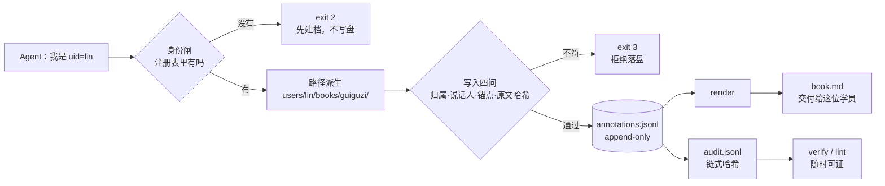

<p align="center">
  <b>同一个 AI 老师，可以有很多学生。<br>但每个学生，只能看见自己的页边。</b>
</p>

<p align="center">
  <code>Marginalia</code> · 多用户共读批注本 · 给陪伴式学习加一层确定性的 IO
  <br>
  <sub>77 tests · Python 3.9+ · 零依赖 · MIT</sub>
</p>

---

## 部署（给 agent：读这一段就够）

**把下面这句话丢给你的 agent，它会自己读协议并部署：**

> 请按仓库里的 `AGENT_DEPLOY.md` 部署这个项目：装 CLI、跑 `marginalia setup`、
> 用 `marginalia setup --check` 自证，最后把 `marginalia doctor` 的输出给我看。
> 找不到技能目录就问我，不要自己猜地址。

**或者你自己跑（四条命令）：**

```bash
# 1) 装 CLI（三选一）
python -m pip install -e .        # 或 ./bin/marginalia（Windows: bin\marginalia.cmd）

# 2) 一条命令部署：建数据根 + 建 owner + 装 skill 副本 + 记账
marginalia setup --root ./study --skills-dir ~/.claude/skills \
  --owner-open-id <你的 sender_id> --owner-name 主人

# 3) 自证：退出码就是结论
marginalia setup --check

# 4) 确认模式与能力边界
marginalia doctor
```

| `--check` 退出码 | 状态 | 含义 | 处置 |
|---|---|---|---|
| `0` | `ready` | 装好了 | 直接说「我想学《某书》」 |
| `1` | `absent` / `partial` | 还没装 / 缺记录 | 回第 2 步 |
| `3` | `stale` | skill 副本过期（仓库改了） | `marginalia setup --force` |
| `3` | `broken` | 数据完整性有问题 | `marginalia verify` 看详情，先别写 |

部署不写任何学员数据；`setup` 幂等，可反复跑。不想它现在就动盘就加 `--dry-run`。

- 完整协议（每步含失败分支）：[AGENT_DEPLOY.md](AGENT_DEPLOY.md)
- 实现细节（维护者向）：[references/deployment.md](references/deployment.md)

---

## 这个词

**Marginalia** —— 拉丁语 *marginalia*，书页**边缘**上留下的字。

中世纪抄书人、文艺复兴的读者、你手上任何一本被真正读过的旧书，都有它：一行原文，旁边一圈小字。不是笔记，不是读书报告，是**一个人在读到那一句时，脑子里响起的声音**。

书是同一个版本，页边的主人不可能是别人。

这就是这个项目要守住的东西。

---

## 它解决的那个具体麻烦

你可能已经有过这样的体验：让 AI 当老师，把书稿丢给它，让它一句一句讲，讲到哪、你问过什么、它怎么回答的，全记在书页边上。读起来像一本**有人陪你读过的书**。

一个人用，很好。

然后你把这位老师介绍给了别人 —— 同事、学生、家里人。

问题从第二个人开始出现：**它开始把别人的笔记，写进你的书里。**

不是它故意。是因为在纯 Markdown 的世界里，它做的是「自由文本编辑」：

- 它要自己记住「我现在在跟谁说话」；
- 它要自己拼出 `study/users/<谁>/<哪本书>.md` 这个路径；
- 它要自己决定 `👤 **谁**：` 后面该填哪个名字。

这三件事，**没有一件是被校验的**。上下文一长、会话一多、同一本书两个人同时在读 —— 它就会错。你的进度出现在别人的批注本里，别人的提问署上了你的名字。而且它错的时候不会告诉你，它看起来跟对的时候一模一样。

这不是模型不够聪明。这是**没有接口**。

---

## 所以：把「谁 / 写到哪 / 写了什么」从模型手里收回来

一句话概括这个项目的设计：

> **模型只能说「我是谁」。它不能决定「写到哪个文件」。**

路径由 `uid` 派生，`uid` 来自注册表。说话人由注册表派生。原文用哈希锁住。批注只追加，不可改。交付物由代码渲染出来，手改没有意义。



`lin` 是另一个人？路径就是另一个。它不是"记得要分开"，是**没法不分开**。

---

## 它长什么样

交付物就是一本普通的 Markdown 书 —— 原文一字不改，对话长在旁边：

```markdown
粤若稽古，圣人之在天地间也，为众生之先。

> 🦞 **【第1课·2026-11-16】** 这句是全书的门。"稽古"不是考据癖，
> 是先把话接到一个更古老的源头上，后面所有判断才站得住。
>
> 👤 **小林**：那"众生之先"是说圣人比所有人早一步？
>
> 💬 **讨论**：不是时间上早，是**看清得早**。所以下一句才是"观阴阳之开阖"。
>
> ✅ **进度**：本段完于 2026-11-16
```

发给学员的，就是这一个文件。打开就能读，不需要数据库，也不需要这个项目。

---

## 两种模式，我把边界写清楚

我没有假设你的 Agent 一定能执行命令。所以：

| | **A · strict** | **B · portable** |
|---|---|---|
| 前提 | Agent 能跑命令（有 shell / Python） | 任意 Agent，只会读写文件 |
| 隔离强度 | **硬**：路径与说话人由代码派生，越权当场拒绝 | **弱**：靠协议约束，模型**可以违反** |
| 何时发现串档 | 写入前拦截（exit 2/3） | 事后审计（`marginalia lint`），只能取证 |
| 适合 | 生产使用、多人共用同一个 Agent | 试水、受限运行时 |

**B 模式不是"同样安全"。** 它只是让隔离有据可查，而不是凭空相信。

如果你能选，选 A。

---

## 五分钟

```bash
git clone https://github.com/hhx465453939/Marginalia.git
cd Marginalia

# 二选一：
python -m pip install -e .        # A. 装成命令 `marginalia`
./bin/marginalia --version        # B. 不安装（Windows 用 bin\marginalia.cmd）

marginalia init --owner-open-id <你的 sender_id> --owner-name 主人
marginalia user add --open-id <对方 sender_id> --name 小林 --goal "读完《鬼谷子》"

marginalia book create --as 主人 --title 鬼谷子 --source ./鬼谷子.md
marginalia note add   --as 主人 --book 鬼谷子 --kind explain --lesson 1 \
  --anchor "粤若稽古，圣人之在天地间也，为众生之先。" \
  --text "这句是全书的门。"

marginalia verify --check-render --strict   # 随时证明：没有串档
```

Windows 上一行都别改，`bin\marginalia.cmd` 会处理好 UTF-8 与中文参数。

> 没装 `marginalia` 命令时，把上面的 `marginalia` 换成 `./bin/marginalia`（Windows：`bin\marginalia.cmd`）即可。

---

## 命令

| 命令 | 作用 |
|---|---|
| `init` | 建数据根 + owner 书房 |
| `user add / resolve / list` | 学员注册表（唯一身份真源） |
| `book create / list` | 开课、入库底本（记 sha256） |
| `chapter mark` | 篇目状态：未讲 / 进行中 / 已讲 |
| `progress set` | 讲到哪 + 下次从哪句接上 |
| `note add` | 追加批注（`--kind explain\|ask\|dialog\|progress\|variant`） |
| `render` | 由真源重新生成 `book.md` |
| `export` | 结课交付 |
| `verify` | 完整性断言：归属、说话人、锚点、原文哈希、审计链 |
| `lint` | 审计**纯 Markdown** 批注本（B 模式取证） |
| `import` | 把旧的单文件批注本迁进来（默认试运行） |
| `stats` / `doctor` | 学习统计 / 环境与能力边界自检 |

---

## 它在磁盘上是什么

```
study/
├── registry.json                    ← 只有这里定义「谁是谁」
└── users/<uid>/
    ├── profile.json                 ← 这位学员的目标与节奏
    ├── audit.jsonl                  ← 谁在什么时候写了什么（链式哈希）
    └── books/<slug>/
        ├── meta.json                ← 底本、版本、进度、接续点、原文 sha256
        ├── source.md                ← 原文（不可变）
        ├── annotations.jsonl        ← 批注（append-only，真源）
        └── book.md                  ← 渲染物（给人读 / 交付，勿手改）
```

`book.md` 不是真源，任何时候都能从另外三个文件重新长出来。

---

## 九道闸

| | 拦住什么 |
|---|---|
| G1 身份 | 不在注册表里的身份，一个文件都不写 |
| G2 路径 | `../`、`a/b`、绝对路径、盘符 —— slug 处即拒 |
| G3 归属 | 书的 uid 与书房 uid 不一致 → 拒写（串档的典型形态） |
| G4 说话人 | `speaker` 只能由注册表派生；幻觉出别人的名字无法落盘 |
| G5 锚点 | 锚点必须在原文中**唯一**出现，否则宁可报错也不猜 |
| G6 原文 | 原文 sha256 不符 → 拒读写（"一字不改"变成断言） |
| G7 审计 | 每次写操作链式留痕；删改任意一行都会断链 |
| G8 并发 | 文件锁，库函数自带（不要求调用方记得加锁） |
| G9 渲染 | `book.md` 与真源不一致 → `verify` 报出 |

---

## 给老师、读书会、班级

我是一名老师，这个项目最初就是从我自己的读书记录里长出来的。它在教学场景里的用法很朴素：

- **一人一间书房**：同一个班，同一本教材，每个人有自己的批注本；交作业交的是「你那一本的页边」，不是一份读后感。
- **进度天然可见**：谁读到哪句、卡在哪个问题、哪一段反复问 —— `stats` 一看就知道该找谁聊。
- **AI 不替你读**：`👤` 那一行是学生自己的话，尽量记原话。老师看的是**他的思考痕迹**，不是 AI 的漂亮总结。
- **结课即成果**：一本书读完，把那本批注本发给他。很多年后他翻出来，看的不是知识点，是当年自己怎么想的。

文科尤其合适：文本细读要的正是「一句话旁边的一圈字」。

---

## 已知边界（不要替它吹）

- 它**不判断教学好坏**。它只管「谁的东西记在谁的书里」。
- B 模式的隔离是**协议级**的，不是强制的。没有执行通道就没有强制力，这是事实。
- 锚点唯一性要求很高：金句反复出现的书（比如《论语》），需要带足上下文才能落笔；这是刻意的取舍 —— 宁可不写，不写错地方。
- 目前只处理 Markdown 底本。EPUB / PDF 需要先转文本。
- 尚未在真实的多用户生产环境里长期跑过；当前证据是 46 项自动化测试。

---

## Roadmap

- [ ] EPUB / PDF 底本直读（含分页锚点）
- [ ] 批注本的排版导出（可打印的分栏本，页边留白）
- [ ] 班级视图：一位老师 × N 位学员的进度总览
- [ ] 复习提示（按遗忘曲线提醒回看某一段）
- [ ] `lint` 规则扩展：跨文件引用检查

---

## 文档索引

| 文件 | 内容 |
|---|---|
| [PRD.md](PRD.md) | 这个项目解决什么问题、不解决什么问题 |
| [SPEC](tasks/CHG-001-multiuser-io/SPEC.md) | 工程契约：九道闸、退出码、ADR、DOR/DoD |
| [TRACEABILITY](tasks/CHG-001-multiuser-io/TRACEABILITY.md) | 需求 → 实现 → 证据 |
| [HEALTH.md](HEALTH.md) | 健康基线：lint/类型/测试/性能实测 |
| [CHANGELOG.md](CHANGELOG.md) | 版本变更 |
| [CONTRIBUTING.md](CONTRIBUTING.md) | 开发与提交规范（三条不可违反的约定） |
| [SECURITY.md](SECURITY.md) | 漏洞报告与隐私边界 |
| [MIGRATION.md](MIGRATION.md) | 从旧版单文件批注本迁过来 |
| [README.en.md](README.en.md) | English |

## License

MIT —— 见 [LICENSE](LICENSE)。

---

<p align="center">
  <sub>
  设计基因：中国画留白（绢色 · 气口 · 一枚印）× 西文古典书页的克制<br>
  它想做到的事，和一本被认真读过的旧书一样：<b>书是同一本，页边的主人是确定的。</b>
  </sub>
</p>
